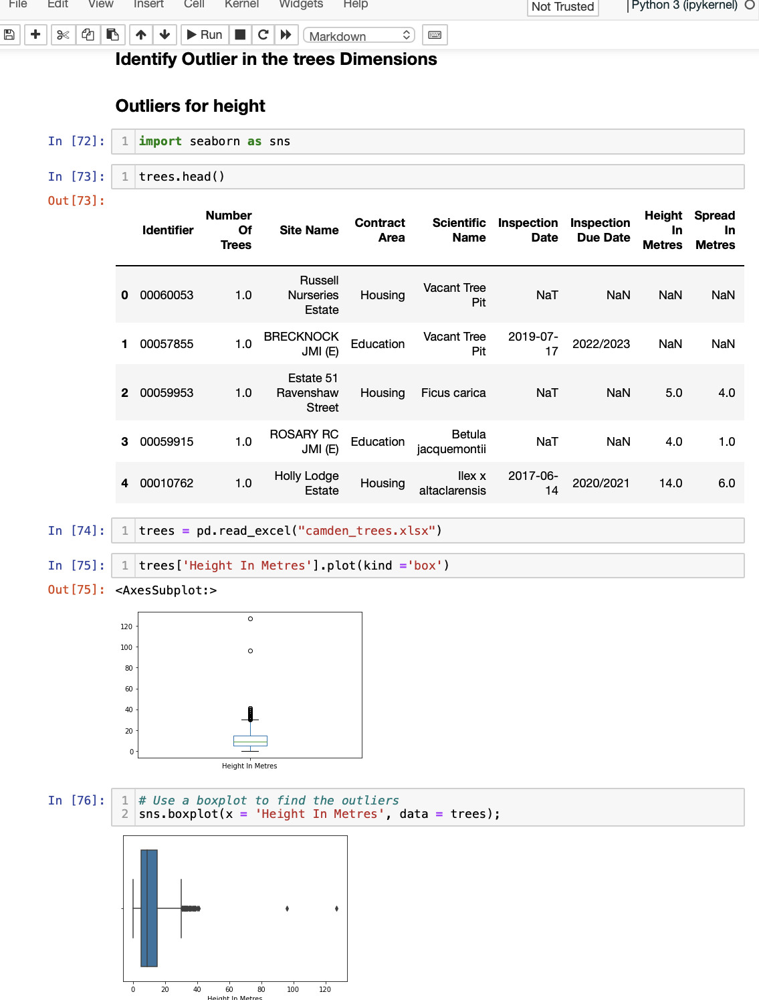
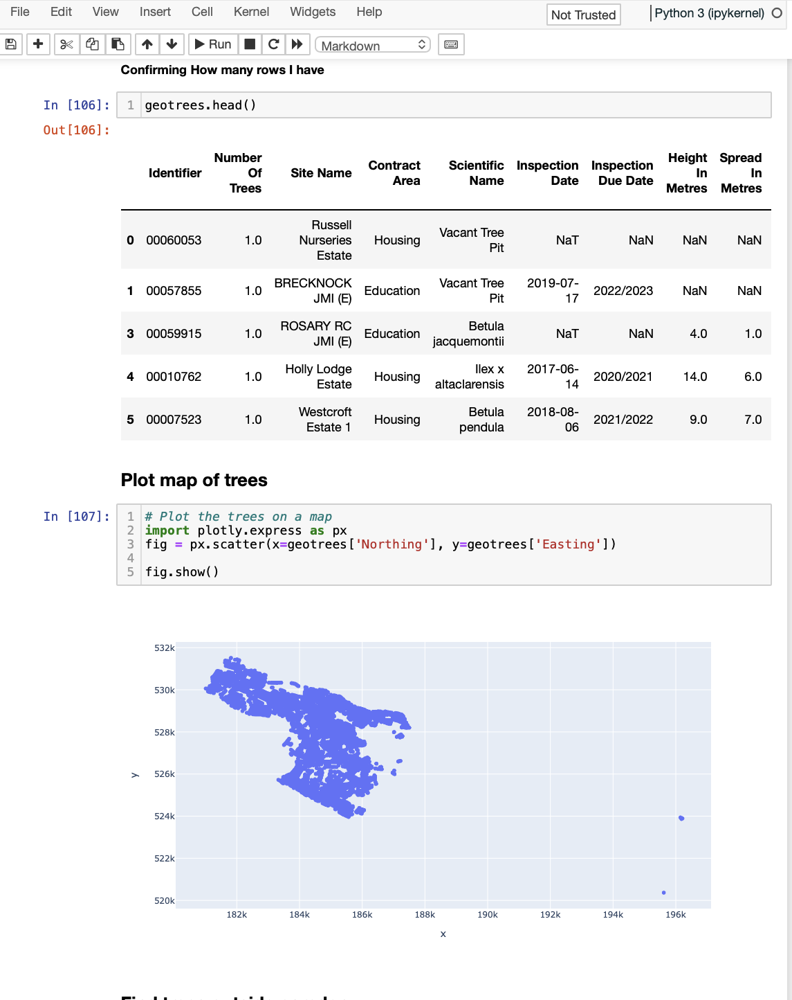
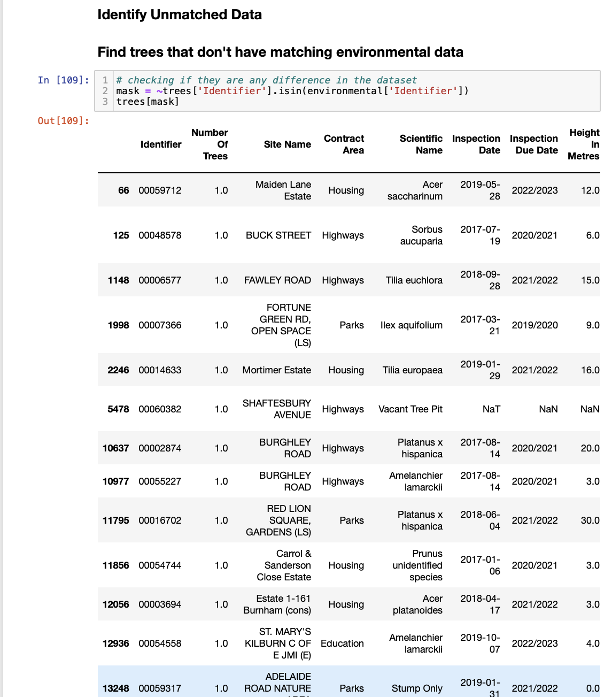

# Camden-Tree-Data-Quality-Analysis
## Project Overview
This project evaluates the quality and usability of Camden tree datasets using Python, Pandas and Jupyter Notebook.
## Tools Used
- Python
- Pandas
- Jupyter Notebook

## Data Sources
- camden_trees.xlsx
- tree_common_names.json
- Environmental dataset used in the original analysis

## Analysis Performed
- Missing value analysis
- Duplicate detection
- Outlier detection
- Geolocation checks
- Unmatched record checks

## Key Findings
- 12 duplicate records identified
- 2 height outliers
- 1 spread outlier
- 5 records with missing geocoordinates
- 23 records without matching environmental data
- 76 records without matching common-name data

## Recommendations
- Standardize data formats
- Remove duplicate records
- Improve missing-value handling
- Introduce validation rules
- Strengthen data governance

- ## Project Screenshots

### Outlier Analysis

### Geolocation Analysis

### Unmatched Data

